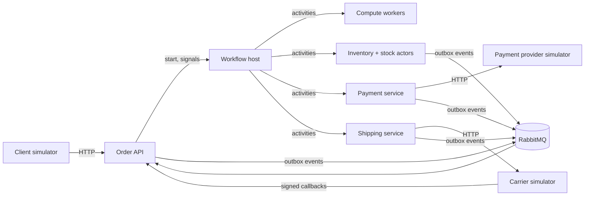

# Dapr Distributed Fulfillment PoC

A proof of concept for distributed order fulfillment with Dapr 1.19 on
.NET 10: Dapr Workflow orchestrates, SQL Server holds the business truth, and
scripted failure drills prove what survives crashes, outages, duplicates,
and races. Synthetic data only; not production software.

**Current release: [v0.6.0](docs/releases/v0.6.0.md)** (milestone M5).
**Results and recommendations: [docs/final-report.md](docs/final-report.md).**

## Contents

- [What It Is](#what-it-is)
- [What It Demonstrates](#what-it-demonstrates)
- [Architecture at a Glance](#architecture-at-a-glance)
- [Status](#status)
- [Quick Start](#quick-start)
- [Verify It Yourself](#verify-it-yourself)
- [Documentation](#documentation)
- [Versions](#versions)
- [Repository Layout](#repository-layout)

## What It Is

An order travels through validation, parallel checks, an optional human
review, stock reservation, payment, packing, and shipment to delivery. Each
step runs on a different service, and every service runs as several
replicas with its own Dapr sidecar. External parties (a client, a payment
provider, a carrier) are separate simulators outside Dapr. They can be
slow, lose answers, repeat themselves, or be down.

The PoC answers one question: **what does Dapr take off your hands in such a
system, and what must the application still own?** The short answer:

- Dapr moves the work: durable workflows with timers and waits, activities
  spread over replicas, actors for hot keys, pub/sub, service invocation.
- The application keeps the truth: every business decision is a SQL
  transaction with an operation key and a stored result, every boundary has
  an intent row and a leased dispatcher, and a fence stops any workflow that
  reaches an order that is already final.

The [final report](docs/final-report.md) explains what this split cost and
gained, and what we recommend.

## What It Demonstrates

Each item is proven by scenario and drill scripts that inject real failures
and read every database ([testing.md](docs/testing.md)).

- **Accept once, start once.** Idempotent order acceptance from any replica;
  the workflow starts once in effect, even when starts are retried or
  replicas die.
- **Durable human review.** Orders from 1,000.00 wait for an operator's
  decision. Approval, expiry, and concurrent decisions are decided in SQL by
  database time; the workflow is only woken.
- **No overselling.** Stock actors serialize reservations, and guarded SQL
  decides them. This holds under contention, actor relocation, and a
  SQL-only mode without actors.
- **Unreliable external parties.** Payment by operation key with
  reconciliation of lost answers and compensation by key; signed carrier
  callbacks recorded under a current-state rule; cancellation until the
  point of no return.
- **Events that reach the read side once, in order.** Outboxes in every
  owning service, at-least-once relays, an event history applied once per
  event id, dead letters, and a rebuild that equals live state.
- **Repair instead of guessing.** Intervention cases for what automation
  cannot decide; a reconciler for faulted, missing, and mismatched
  workflows; repair workflows; an explicit `Escalated` end for a confirmed
  delivery failure.
- **Operability.** Seventeen alert rules, each checked in the drill that
  causes it; eight Grafana dashboards; runbooks; workflow versioning with
  patches and per-host rollout; outage and scaling drills.

## Architecture at a Glance



Every Dapr role has its own database on one SQL Server, written only by its
owner. Workflow and actor state live in a separate Dapr state database.
Details: [architecture.md](docs/architecture.md).

## Status

| Version | Milestone | Theme |
|---|---|---|
| v0.1.0 | M0 | foundation: stack, sidecars, failure-injection harness, CI |
| v0.2.0 | M1 | durable acceptance, start once, execution fence, reviews |
| v0.3.0 | M2 | inventory under contention |
| v0.4.0 | M3 | payment, shipping, cancellation, interventions |
| v0.5.0 | M4 | event distribution, history, reconciler |
| **v0.6.0** | **M5** | alerts and dashboards, workflow versioning, outage and scaling drills, actor versus SQL-only comparison |

- Every guarantee was demonstrated on Docker Compose with two or three
  replicas per role.
- A generic [Kubernetes template](deploy/kubernetes/README.md) exists and has
  a smoke test on a local kind cluster; the drills have not been run on
  Kubernetes.
- Known limitations of the current release: [v0.6.0.md](docs/releases/v0.6.0.md#known-limitations).
  The most important: on Dapr 1.19.1 a workflow instance that recorded a
  versioning patch must not be terminated
  ([operations.md](docs/operations.md#never-terminate-a-patched-workflow)).

## Quick Start

Requires Docker with Linux containers, Compose v2, Git Bash or Bash, Python 3,
and about 4 GB of free Docker memory.

```bash
bash scripts/init-env.sh                      # .env with random secrets
bash scripts/stack-up.sh                      # build, start, wait until ready
bash scripts/scenarios/S00-runtime-smoke.sh   # PASS/FAIL runtime checks
bash scripts/reset.sh --yes                   # remove everything, including data
```

Or take the guided tour, which explains and checks each step:
`bash scripts/walkthrough.sh --fresh` ([walkthrough.md](docs/walkthrough.md)).
Then submit orders with the client simulator
([client-simulator.md](docs/client-simulator.md)) and watch them in Grafana
and Jaeger ([getting-started.md](docs/getting-started.md#local-endpoints)).

## Verify It Yourself

```bash
bash scripts/walkthrough.sh --fresh                # a guided tour with checks, about 10 min
bash scripts/verify.sh --suite full --keep-awake   # every check on fresh stacks, about 90 min
bash scripts/verify.sh --suite dev                 # development regression on one drill stack
bash scripts/verify.sh --only R17 --reuse          # one drill on a running drill stack
bash scripts/kind-smoke.sh                         # the Kubernetes template on a kind cluster
```

Results land in `artifacts/` with the commit, tree state, and every
assertion's expected and observed values.

## Documentation

| Start here | |
|---|---|
| [walkthrough.md](docs/walkthrough.md) | a guided six-step tour with checks: `bash scripts/walkthrough.sh --fresh` |
| [final-report.md](docs/final-report.md) | what was learned: answers, lessons, recommendations, further work |
| [guarantees.md](docs/guarantees.md) | every guarantee, who provides it, and the check that demonstrates it |
| [getting-started.md](docs/getting-started.md) | prerequisites, startup, endpoints, your first order, stop and reset |
| [architecture.md](docs/architecture.md) | roles, state authority, workflow, boundaries, events, reconciler |

| Run and operate | |
|---|---|
| [configuration.md](docs/configuration.md) | secrets, settings, Dapr components, time profiles, build flavors |
| [operations.md](docs/operations.md) | scripts, health, alert runbooks, workflow rollout, restarts, troubleshooting |
| [monitoring.md](docs/monitoring.md) | traces, metrics, alert rules, dashboards |
| [security.md](docs/security.md) | trust boundaries and secrets |
| [client-simulator.md](docs/client-simulator.md) | the external client: commands, seeded runs, replay, operator decisions |
| [deploy/kubernetes/README.md](deploy/kubernetes/README.md) | the Kubernetes template and its kind smoke test |

| Verify and evaluate | |
|---|---|
| [testing.md](docs/testing.md) | unit and integration tests, scenarios, drills, what each check proves |
| [resilience-drills.md](docs/resilience-drills.md) | failure injection and its safety |
| [dapr-vs-alternatives.md](docs/dapr-vs-alternatives.md) | stock actors versus SQL-only coordination, measured |
| [versions.md](docs/versions.md) | pinned versions and observed Dapr runtime behavior |
| [journal.md](docs/journal.md) | everything that broke, why, and what changed |

| Releases | |
|---|---|
| [CHANGELOG.md](CHANGELOG.md) | all releases |
| [v0.6.0](docs/releases/v0.6.0.md) | M5: alerts, versioning, outage and scaling drills, comparison |
| [v0.5.0](docs/releases/v0.5.0.md) | M4: event distribution, history, reconciler |
| [v0.4.0](docs/releases/v0.4.0.md) | M3: payment, shipping, interventions |
| [v0.3.0](docs/releases/v0.3.0.md) | M2: inventory |
| [v0.2.0](docs/releases/v0.2.0.md) | M1: acceptance, start once, reviews |
| [spikes/dapr-compat](spikes/dapr-compat/README.md) | the Dapr 1.19 compatibility spike |

## Versions

Pinned 2026-11-18 (each release at least two weeks old); all pins, dates, and
observed runtime behavior: [docs/versions.md](docs/versions.md).

| Component | Version |
|---|---|
| .NET SDK / runtime | 10.0.403 / 10.0.14 |
| Dapr runtime (daprd, Placement, Scheduler) | 1.19.1 |
| Dapr .NET SDK | 1.19.0 |
| EF Core | 10.0.14 |
| SQL Server | 2022 CU27 |
| RabbitMQ | 4.3.6 |
| OpenTelemetry .NET / Collector | 1.20.1 / 0.163.2 |
| Jaeger / Prometheus / Grafana | 2.22.0 / 3.15.1 / 13.3.0 |
| Toxiproxy | 2.13.0 |

## Repository Layout

```text
src/              .NET solution (Fulfillment.slnx): roles, simulators, shared libraries, tests
dapr/             Dapr components and sidecar configuration
db/init/          database and login creation
deploy/compose/   Compose support files (Toxiproxy)
deploy/kubernetes/ Kubernetes template (Kustomize base and overlays)
monitoring/       Collector, Prometheus rules, Alertmanager, Grafana provisioning
scripts/          stack, scenario, drill, check, and experiment scripts; verify.sh
ci/               build gates shared by CI providers
docs/             documentation and release notes
spikes/           the Dapr compatibility spike (kept as reproducible evidence)
```

License: [MIT](LICENSE).
